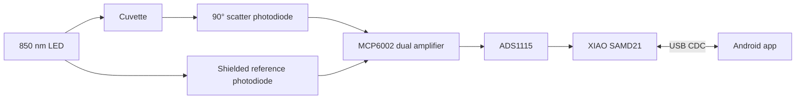

# Citizen-science turbidimeter

A compact optical instrument powered and controlled by an **Android USB-C
phone**, with no battery or built-in display.

Design: **Ing. Alex M. Rivera**. Updated **26 October 2026**.

The prototype combines two stacked PCBs, an 850 nm infrared LED, two BPW34
photodiodes, an MCP6002, an ADS1115 and a XIAO SAMD21. The firmware measures
a dark-corrected scatter/reference **optical ratio**. Android version **0.5**
can convert that ratio using a calibration against a reference turbidimeter.

## Current status

| Part | Verified / available | Next step |
| --- | --- | --- |
| Electronics | Assembled prototype; ADS1115 acquisition and both optical channels respond on the Mac | Verify complete operation with water-filled cuvettes and compatible phones |
| Firmware | Real USB-CDC readings, dark subtraction, ratio and hardware-error reporting; LED on **D10** | Characterize response, noise and range across samples |
| Android | Real readings, reference calibration, marked extrapolation, local history, CSV and calibration JSON transfer | Validate calibration with a reference instrument and complete phone/release checks |
| Enclosure | Printed body/lid sources and assembled closed-enclosure bench tests | Confirm optical alignment, cable support and sealing in the finished instrument |
| Quantitative turbidity | Calibration workflow implemented | Obtain reference measurements, calibrate and validate independent samples |
| Citizen-science platform | Not implemented; app currently works offline | Define the platform and optional data-upload workflow |

On **26 October**, after wiring repairs and a direct XIAO-to-ADS ground jumper,
20 controller-only acquisitions completed without errors. The complete sensor,
with its **enclosure closed and an empty cuvette**, then completed **20/20**
measurements: mean optical ratio **6.902305**, short-run CV **0.0760%**.
This demonstrates repeatability under that condition, **not turbidity accuracy**.
Water-filled-cuvette testing is deferred; no zero-turbidity blank or usable
FNU/NTU range has been established. See the [bench records](firmware/xiao_samd21_turbimeter/bench/README.md).

The original 18 October target is retained as project history. Calibration and
independent validation are still required before community deployment.

## Repository map

| Folder | Purpose / entry point |
| --- | --- |
| [hardware/](hardware/README.md) | Sensor/base KiCad project: `esque.kicad_pro`; custom libraries and base manufacturing exports |
| [hardware-controller/](hardware-controller/README.md) | Independent controller/ADC KiCad project: `controller.kicad_pro`; local libraries, models and exports |
| [3D/](3D/README.md) | Current enclosure: `cuerpo.stl`, `tapa.stl` |
| [firmware/xiao_samd21_turbimeter/](firmware/xiao_samd21_turbimeter/README.md) | Active XIAO firmware, wiring, upload instructions and recorded bench sessions |
| [android-app/](android-app/README.md) | Android app, calibration, tests and Google Play preparation |
| [docs/](docs/README.md) | Optical design, purchase list, BOM notes and privacy policy |
| [hardware/archive/](hardware/archive/) | Earlier electronic designs and retired manufacturing exports |
| [img/](img/) | Earlier prototype photos and animations; not current manufacturing references |

Open the base and controller as **separate KiCad 9 projects**. Their current
saved PCB files are the editable sources. Existing Gerbers, assembly renders
and older validation reports are revision snapshots; check their notes before
manufacturing. Repository organization preserves the saved PCB routing.

## Measurement chain

The cuvette has a **10 mm optical path** and a provisional **12.5 × 12.5 mm
exterior**. The reference photodiode monitors a fixed fraction of the LED light.
Each acquisition reads both channels with the LED off and on, subtracts the
dark readings, and divides corrected scatter by corrected reference.

The XIAO's regulated **3.3 V** rail supplies the ADC and analog circuit.
**D4 = SDA, D5 = SCL, D10 = LED control (KiCad A1 pin 11)**.
The LED uses resistive current limiting. The assembled prototype was reported
with **100 kΩ R1/R2**, whereas the schematic starting value was 1 MΩ; see the
[optical design notes](docs/optical-design.md) before replicating it.

**An optical ratio is not FNU/NTU.** Reference calibration and independent
validation are required. Repeatability alone does not establish accuracy,
water safety, ISO/EPA compliance or performance across different phones.

## Use the prototype

1. Upload the [active XIAO firmware](firmware/xiao_samd21_turbimeter/README.md).
   Verify a common ground and a 3.3 V ADS supply. Controller-only tests need
   the documented direct ground jumper.
2. Use a data-capable USB connection. On the Mac, `PING` checks the link;
   `RAW` inspects LED-off/on ADC counts, and `MEASURE` returns an optical ratio.
3. Build/install the [Android app](android-app/README.md) on a phone with
   **USB host/OTG** support, then use **Connect sensor → Measure now → History**.
4. Once a reference instrument is available, open **Calibration** and pair
   five sensor readings per sample with its reference value, for **3–12 points**.
   Check additional samples that were not used to fit the curve.

The app joins calibration points with straight lines. Outside the measured
range it extends the nearest end segment and marks the estimate
**EXTRAPOLATED**. Curves belong to the sensor's USB identity. History retains
UTC time, optical ratio and calibration ID; CSV and calibration JSON can be
exported. A replacement XIAO has a different identity and needs its own curve.

**This release has no online upload, contributor form or location capture.**
USB 2.0 uses VBUS, GND, D− and D+; USB-C role detection must also be handled
by suitable plugs or an OTG adapter. Four wires alone do not establish phone
compatibility. Earlier carrier USB links are historical; check the saved
boards and actual cable termination in the [hardware notes](hardware/README.md).

## Procurement and development

The current [English purchase workbook](docs/shopping-list-prototype-usb-c.xlsx)
is the latest user-edited copy, consolidated under `docs/`. It contains direct
supplier links; prices have **not** been refreshed during this repository
update. Read the [BOM revision notes](docs/BOM.md) before ordering. The earlier
29 September workbook is retained in [docs/archive/](docs/archive/).

Build and software-check instructions are in the [Android README](android-app/README.md).
Publication tasks are in the [Google Play checklist](android-app/play-store/release-checklist.md).
Build outputs, signing keys, tester addresses, IDE settings and local SDK paths
are excluded from Git. APKs/AABs are generated locally; they are not release
artifacts published by this commit.

The [SEN0189 sketch](firmware/legacy_sen0189/),
[experimental Nano/TL072 sketch](firmware/firmware.ino) and
[legacy firmware notes](docs/firmware.md) are historical references, not the
active XIAO implementation.
