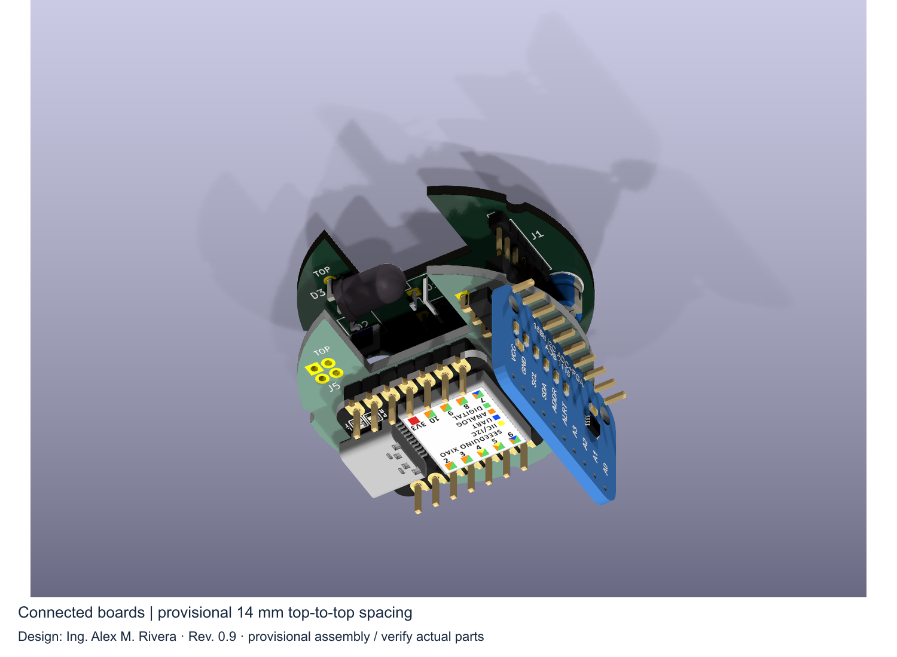
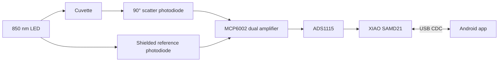
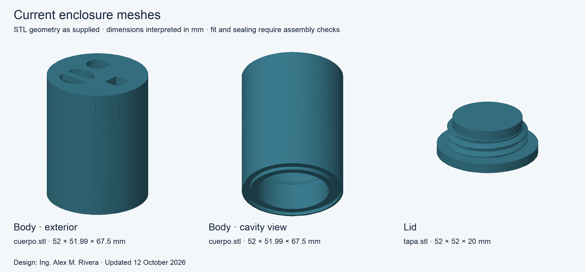

# Citizen-science turbidimeter

A compact, reproducible instrument for measuring water turbidity with an
**Android USB-C phone as its power supply, screen and controller**.

Design: **Ing. Alex M. Rivera**. Updated **13 October 2026**.

The current prototype combines a custom optical sensor, two stacked carrier
PCBs, a printed enclosure and an Android app. It has **no battery or display**.
The aim is a reliable quantitative result after calibration and independent
validation. The current firmware reports an **uncalibrated optical ratio**.

*Upper revision 0.10 aligned to the user-routed base. Upper traces remain pending; connector reach,
module dimensions and enclosure fit require a physical assembly check.*

## Current status

| Part | Available now | Remaining work |
| --- | --- | --- |
| Electronics | User-routed base and aligned upper PCB; upper electrical and placement checks pass | Route the upper PCB, review base DRC findings, verify outputs, fabricate and solder |
| Enclosure | Updated body and lid meshes: `cuerpo.stl` and `tapa.stl` | Check the complete stack, optical alignment, USB plug, gland and lid seal |
| Firmware | XIAO SAMD21 USB-CDC firmware; dark/lit acquisition, ratio and hardware errors | Test with the assembled ADS1115 and optical circuit; add validated calibration |
| Android app | Version 0.4: connect, measure, local history, CSV sharing, privacy and deletion; Google Play closed-test preparation | Test the release with the completed instrument and finish the Play checklist |
| Quantitative measurement | Calibration and validation plan | Measure standards and independent samples; establish range, uncertainty and reportable unit |

**Target: instrument, app, calibration and validation ready by 18 October
2026. Community deployment follows that date.** This is a development target;
the assembled optical instrument has not yet been validated. Google Play
publication follows its separate testing and review process.

## How it works

An **850 nm infrared LED** illuminates a sample in a spectrophotometer cuvette
with **10 mm optical path** and a provisional **12.5 × 12.5 mm exterior**.
A BPW34 photodiode detects light scattered at **90°**. A second, shielded BPW34
monitors a fixed fraction of the LED output.

For each measurement, the firmware reads both channels with the LED off and
on, subtracts the dark readings and calculates the scatter/reference ratio.
This approach is intended to reduce sensitivity to LED-output changes; its
performance must be demonstrated with the real instrument and different phones.

The XIAO's regulated **3.3 V** rail powers the analog circuit and ADS1115.
A **10 µF rail capacitor** provides additional decoupling. D7 controls the LED
through two series 220 Ω resistors; the circuit limits current with resistors.
LED current, amplifier gain, noise and saturation remain bench-test items.

**A ratio is not an FNU/NTU value.** Calibration with known turbidity standards,
a defined valid range and independent validation are required before reporting
turbidity. See the [optical design and validation plan](docs/optical-design.md).

## Two stacked PCBs

| Floor | Project | Main parts |
| --- | --- | --- |
| Base: sensor and cable entry | [hardware/esque.kicad_pro](hardware/esque.kicad_pro) | LED, two BPW34s, MCP6002, passives, J2 cable holes and J1/J4 interboard links |
| Upper: controller and ADC | [hardware/controller/controller.kicad_pro](hardware/controller/controller.kicad_pro) | XIAO SAMD21, upright ADS1115, C5, mating J1/J4 sockets and J5 pigtail holes |

- **Upper solder/copper face: F.Cu.** Through-hole components mount on B,
  physically upwards; SMD sockets and solder joints are on F, underneath.
  The base routing is retained as supplied; upper routing remains manual.
- The proven base outline and its cable relief are retained. The upper PCB
  fills that relief and keeps the cuvette opening.
- Modules may overhang the carriers within the **44 mm internal cylinder**.
- J1 carries analog signals, LED control and 3.3 V power. J4 carries the four
  USB 2.0 power/data signals. J2/J5 are **four bare through-hole wire lands**.
- The preferred stack height is **35 mm**. The present provisional budget is
  **36–38 mm**, before lid clearance and cable bends; it is not a verified fit.

[Assembly, connector pinouts and routing notes](hardware/README.md) ·
[Board views and individual/connected renders](hardware/pcb-top-preview.svg) ·
[Validation results](hardware/validation.md)

The base exports are retained as supplied by the user. Generate the upper
fabrication set after routing, and review both boards before manufacture.

## Updated enclosure

The current printable meshes are [cuerpo.stl](3D/cuerpo.stl) (body) and
[tapa.stl](3D/tapa.stl) (lid). They replace the earlier separate case, neck,
sensor-holder and lid exports. Dimensions, source notes and assembly checks
are in the [enclosure README](3D/README.md).

The closed instrument uses a fixed cable through one gland. Verify cable
strain relief, the actual gland diameter, the lid seal, light exclusion and
the USB pigtail clearance before closing it. The STL files alone do not
establish a watertight assembly or optical alignment.

## Android app and USB connection

The app works locally: **Connect sensor → Measure now → History**. Real
readings are saved with their UTC timestamp and calibration status, and can
be shared as CSV. Privacy explains local storage and allows deletion.
**This release has no online upload, contributor form or location capture.**

The phone must support **USB host/OTG**. The current carriers carry four
signals: VBUS, GND, D− and D+. USB-C role detection must be handled correctly
in the plugs or OTG adapter; four conductors alone do not prove compatibility.
The cable runs through base J2, interboard J4 and upper J5 to a short USB-C
pigtail plugged into the XIAO. Its 14 edge pins do not expose USB data.
The left-facing socket needs a compact plug and a physical clearance check.

[App setup and serial protocol](android-app/README.md) ·
[Current firmware and upload instructions](firmware/xiao_samd21_turbimeter/README.md) ·
[Google Play closed-test checklist](android-app/play-store/release-checklist.md)

The XIAO-only USB bench test verified `PING` and the expected missing-ADC
error. It did not validate an optical reading. The complete sensor and app
must be tested together after assembly.

## Procurement

The [English purchase workbook](docs/shopping-list-prototype-usb-c.xlsx)
contains supplier links and VAT-inclusive prices for one prototype. It
predates the current stack: **do not order directly from it without reading
[BOM revision notes](docs/BOM.md)**. Those notes cover the XIAO replacement,
SMD passives, interboard connectors, carrier PCBs and USB pigtail.
Check stock before ordering; the cuvettes and XIAO are already available.

## Work before 18 October

1. Route the aligned upper PCB, review the existing base findings and check the real modules, mating connectors,
   cuvette, optics and cable against the updated enclosure.
2. Generate and verify manufacturing files, fabricate the carriers, solder
   the assembly and check power, LED current and USB communication.
3. Test firmware acquisition, dark subtraction, reference level, noise,
   saturation and repeatability with the real optical circuit.
4. Calibrate with known standards; validate independent samples, the usable
   range and uncertainty, including measurements across compatible phones.
5. Test the Android release with the complete sensor: connection, measurement,
   history, CSV export, privacy, deletion and restart. Complete the Play
   closed-test steps before wider distribution.

Community deployment is the phase after 18 October.

## Earlier designs

The [SEN0189 firmware](firmware/legacy_sen0189/),
[experimental Nano/TL072 sketch](firmware/firmware.ino),
[earlier circuit drawing](docs/diagrams/legacy-circuit-schematic.svg) and
[archived KiCad revisions](hardware/archive/) are retained as references.
They are not the active XIAO design. Older enclosure animations remain in
`img/3d/`; current geometry is in `3D/`.
