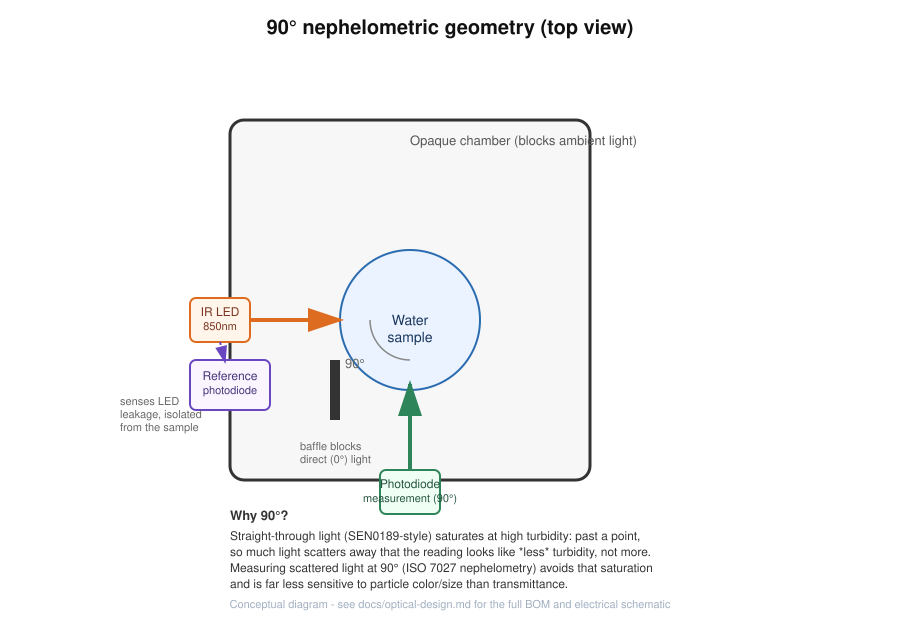

# Optical design and validation plan

Design: **Ing. Alex M. Rivera**.

## Target and status

Build one closed turbidimeter that any compatible Android USB-C phone with USB
host support can power and read. Calibration belongs to the instrument, not
to a particular phone: changing phones must not require new coefficients.
The Android 0.5 release reads the instrument, supports reference calibration,
keeps local history and exports CSV. Online upload, contributor identity and location capture are deferred;
the citizen-science API is not specified. The instrument has no battery,
screen, or status LEDs. The assembled optical circuit now produces real
uncalibrated ratios on the Mac; quantitative accuracy remains unvalidated.
The original 18 October target has passed; calibration and independent
validation remain prerequisites for community deployment. See the
[26 October bench records](../firmware/xiao_samd21_turbimeter/bench/README.md).

The DFRobot SEN0189 sensor and its firmware are retained only as an earlier
prototype. The reviewed monolithic schematic is archived. The active
[two-floor KiCad assembly](../hardware/README.md) separates the sensor/base
from the upper XIAO + upright ADS1115. Through-hole electronics face upwards;
SMD parts mount underneath.
The active J1 connection now uses a 2.54 mm THT socket on the base and an SMD
male header under the controller. The saved boards include subsequent builder
routing and component changes; historical 3D views are not the current
placement reference. The base contour and cuvette opening remain the design
reference, with a nominal 12.5 × 12.5 mm cuvette exterior and a 44 mm cylinder
allowance. Actual connector engagement, optical alignment, cable support,
sealing and total stack height require physical checks.

The USB connection uses the XIAO socket. Earlier J2/J4/J5 carrier links are a
retired layout; consult the saved PCB files and actual cable assembly.
USB-C role detection must be handled correctly by the plugs/OTG adapter.
The [one-unit purchase workbook](shopping-list-prototype-usb-c.xlsx) is the
latest user-edited copy; the [BOM notes](BOM.md) explain as-built differences.
Prices have not been refreshed during repository organization.

## Optical and electrical concept

An 850 nm IR LED illuminates the sample. One BPW34 photodiode measures light
scattered at 90°; a second, shielded from the sample, monitors the LED. Read
both photodiodes with the LED off and on, subtract the dark readings, and form
a scattered/reference ratio. This ratio compensates for some changes in LED
output, but **it is not an NTU value** by itself.

The intended signal chain is:

| Stage | Planned part / connection |
| --- | --- |
| Illumination | 850 nm IR LED controlled by XIAO SAMD21 D10 (KiCad A1 pin 11) through a verified current-limited circuit |
| Detection | Two BPW34 photodiodes: 90° scatter and shielded reference |
| Amplification | MCP6002 dual amplifier at 3.3 V; schematic starting value 1 MΩ, builder reports 100 kΩ fitted for bench tests |
| Conversion | ADS1115 at 3.3 V, with the two amplifier outputs on AIN0 and AIN1; I²C to XIAO D4/D5 |
| Phone interface | USB-C XIAO SAMD21, data-capable 2 m USB-C cable, Android USB host app |

The schematic starts with a 1.65 V midrail reference, 1 MΩ/10 pF feedback
per MCP6002 channel, and two 220 Ω resistors in series with the IR LED from
D10 (about 4 mA at a 1.4 V LED drop). These are **bench starting values**.
The XIAO regulates USB power to 3.3 V. A 10 µF capacitor across that rail
helps with short transients; it does not set the LED current. The shielded
reference photodiode must see a fixed fraction of the LED light so the
dark-subtracted scatter/reference ratio can correct residual light-output
changes. This correction must be demonstrated with different phones.
The BPW34 cathodes go to the inverting inputs and the anodes to ground;
the amplifier outputs should rise with light. Verify the actual polarity,
output range, LED current, I²C pull-ups on the ADS1115 breakout, saturation,
ambient-light rejection, and repeatability before ordering a PCB. The old
[`legacy-circuit-schematic.svg`](diagrams/legacy-circuit-schematic.svg) uses a
TL072 and status LEDs; it is **not** a schematic for this build. Likewise,
[`firmware/firmware.ino`](../firmware/firmware.ino) is the older sketch that
outputs a relative index and controls LEDs. The current USB bench sketch is
[`xiao_samd21_turbimeter.ino`](../firmware/xiao_samd21_turbimeter/xiao_samd21_turbimeter.ino).

## Enclosure and USB cable

The current enclosure is supplied as [cuerpo.stl](../3D/cuerpo.stl) and
[tapa.stl](../3D/tapa.stl). These replace the earlier four separate exports.
The [enclosure notes and preview](../3D/README.md) record the overall mesh
dimensions; they do not verify the internal 44 mm envelope or complete PCB fit.

The earlier purchase workbook specifies Goobay 66508 (USB-C to USB-C,
5.5 ± 0.15 mm outer diameter) and a 3–6.5 mm M12 gland. The user's actual
four-wire cable has not been identified. Check its diameter against the gland.
The current carriers use only VBUS/GND/D−/D+ through THT J2/J5. A phone-side
OTG/Rd plug or adapter and a compatible micro-side legacy USB-C plug are
required; a normal C-to-C cable needs its CC path and cannot be converted
by simply dropping that wire. See the [assembly instructions](../hardware/README.md).
Verify host operation, both plug orientations, mechanical strain relief and
sealing before closing the enclosure. The left-facing XIAO socket needs a
compact plug; the provisional 5.5 mm plug-tail allowance needs a dry fit.
Verify lid dimensions before choosing an O-ring from the assortment.

## From optical ratio to quantitative turbidity

1. Fix the final optical geometry and record LED-off/LED-on readings from both
   channels, including the clear-water background.
2. Measure known turbidity standards spanning the intended range with the
   same sample vessels and handling procedure. The Hanna HI98703-11 set is a
   purchase candidate; check ULB stock, vessel compatibility, and quote.
3. Fit a calibration curve only after inspecting the measured response.
   Store its coefficients and calibration identity with the device/app data.
4. Check independent samples and repeat measurements. Record the range,
   error, repeatability, drift, and any region where the sensor saturates.
5. With one instrument, one cable, one standard and unchanged calibration,
   repeat the measurement on several Android USB-C host phones (including
   different models and battery levels). Record USB voltage, 3.3 V rail,
   dark/lit detector signals and the corrected ratio. Verify that differences
   stay within the instrument's stated measurement uncertainty; reject a
   measurement if the phone cannot power or enumerate the instrument.
6. Show a quantitative result only when the calibration and reportable unit
   are valid for that range; otherwise
   label the reading as an uncalibrated optical ratio or out of range.

The current Android app does not upload readings or collect location. A future
upload feature must remain optional and include reading, unit, calibration
identity, timestamp and quality status. Contributor signature and acquisition
location belong to that later feature and require explicit user controls.
