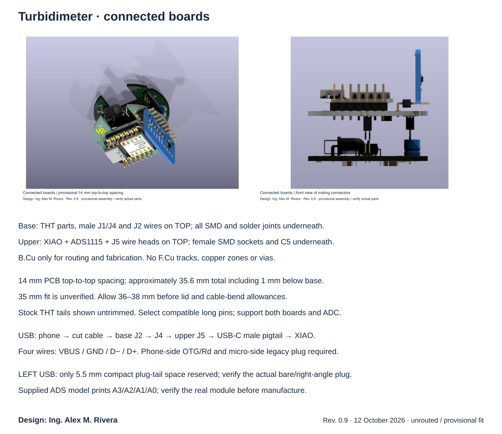

# Two-floor turbidimeter electronics — revision 0.9

Design: **Ing. Alex M. Rivera**. Updated 12 October 2026.

Two KiCad 9 projects contain schematics and placed **unrouted** PCBs. All
tracks and copper zones remain for manual routing.

| Floor, bottom to top | Open this project | Components |
| --- | --- | --- |
| 1 — Sensor / cable entry | [esque.kicad_pro](esque.kicad_pro) | Optics, MCP6002, passives, C6, sensor link J1, four THT wire holes J2, USB link J4 |
| 2 — Controller + ADC | [controller/controller.kicad_pro](controller/controller.kicad_pro) | XIAO SAMD21, upright ADS1115, C5, J1/J4, four THT pigtail holes J5 |

The **base contour is unchanged**. Only the lower-left USB cable relief is
filled on the upper PCB; the cuvette opening and other mounting reliefs are
preserved. A **44 mm circle on Dwgs.User** marks the available cylinder space,
not a milling line. Module bodies may overhang the carrier within that circle.

Shared symbols and footprints are in [Turbimeter.pretty](Turbimeter.pretty/)
and the project library tables. The [single-board source](archive/single-board-v0.5/)
and [previous three-floor design](archive/three-floor-v0.6/) are archived.
The old separate ADC project is retired. Existing Gerbers/STL predate this
revision and **must not be used to manufacture this assembly**.




## Assembly and height

**Single-face fabrication: B.Cu is the only copper layer to route and export.**
Through-hole components mount on TOP (F); all SMD mount on BOTTOM (B).
All solder joints are made from BOTTOM. TOP/BOTTOM marks are on the relevant
silkscreens; the PCB drawing and fabrication layers list the mounting rule.
KiCad keeps two logical copper layers and conventional PTH annuli on both;
**omit F.Cu from fabrication outputs**. No F.Cu tracks/zones or vias are allowed.
A single-face layout may need insulated top-side wire jumpers where traces
cannot cross; resolve that during manual routing. Confirm the fabricator's
single-layer drill/plating process before ordering.

Base J1/J4 are **male THT on TOP**, soldered underneath. Upper J1/J4 are
**female SMD on BOTTOM**. This orientation makes both boards solderable on
one face. Upper A1/U2 and wire heads at J5 are on TOP; C5 is underneath.
Base R1–R6 and C1–C4 are underneath; D1/D2/D3/U1/C6 and wire heads at J2 stay on TOP.
J2/J5 are four **1 mm through-holes**, arranged 2×2 at 2 mm pitch; no header is fitted.
The ADS1115 stands along the right wing. XIAO lies flat, rotated with USB
facing LEFT, following the supplied placement suggestion. The on-disk file
still contained the old orientation, so the suggestion was reconstructed
from the screenshot and adjusted for copper and mounting clearances.
J1 now runs down the right wing; J4 is at the bottom. C6 was moved below J1,
R3/R4 adjusted underneath, and C5 placed beneath XIAO near the ADS header.
The proposed left-side J4 would interfere with the base optical assembly.

**35 mm remains the preferred overall height, not a verified fit.** The
provisional budget from base underside to upright module top is:

| Item | Estimated dimension |
| --- | --- |
| Space below base for SMD / trimmed solder tails | Approximately 1 mm; cable bends need additional clearance |
| Base thickness | 1.6 mm |
| Base top → upper PCB top | 14 mm (12.4 mm clear gap for 1.6 mm upper PCB) |
| Upright ADS1115 assembly above upper PCB | Approximately 19 mm, including ≥2 mm bottom clearance |
| Total | 1 + 1.6 + 14 + 19 = 35.6 mm; provisionally allow 36–38 mm, before lid clearance |

The module is **estimated**, approximately 29 × 18 mm with 18 mm vertical,
1×10 header at 2.54 mm pitch. The supplied 3D board body projects
within X 49–50.6, Y 19.18–47.33 mm on Dwgs.User; its components and
header tails extend beyond that body outline. Confirm the delivered module's
pin order, dimensions, header setback and component side before fabrication.
Its lower edge is modelled about 2 mm above the upper PCB. C5 is underneath;
check the breakout's existing local decoupling and route its supply return.
The supplied ADS STEP represents a different variant, including printed
A3/A2/A1/A0 order; the schematic remains A0/A1/A2/A3 pending confirmation
from the real module. **The 3D model is not the pinout authority.** The supplier
[lists the intended 006632 module as 29 × 18 mm](https://www.tinytronics.nl/en/sensors/current-voltage/ads1115-adc-module-16-bit-i2c-4-channels).

Select compatible connectors with sufficient reach for the 12.4 mm gap;
footprint pad geometry does not define a purchased part's mating height.
Use low-profile XIAO mounting with clearance above the carrier, and
verify the USB plug/bend inside the 44 mm cylinder. Guides/spacers must
support both floors and the upright module. Confirm C6 and sideways optical
bodies below the upper PCB in a dry assembly.

## Connections between floors

View both boards from above in the same orientation. Bottom-side viewing
mirrors the image. Mating contact axes align; the SMD solder pads are offset
from those axes. Keep both connector placements fixed while routing.

| Connector | Pitch | Base F male → upper B socket | Pins in order |
| --- | --- | --- | --- |
| J1 | 1×6, 2.00 mm | Analog / power | 1 GND; 2 3V3; 3 LED_DRIVE; 4 SCATTER_OUT; 5 REFERENCE_OUT; 6 GND |
| J4 | 2×2, 1.27 mm | USB 2.0 | 1 USB_VBUS; 2 GND; 3 USB_DM; 4 USB_DP |

J1 pin 1 contact is X 47.30, Y 24.00 mm; pins advance +Y by 2 mm.
J4 pin 1 contact is X 33.50, Y 47.00 mm; even pins are 1.27 mm to the
right, and the second row advances +Y by 1.27 mm. Pin numbers match across
floors. The tall base pins are the two interboard links, not spare test pins.

J1 analog outputs go directly to U2 AIN0 (scatter) and AIN1 (reference).
XIAO D4/D5 connect to SDA/SCL. ADS1115 ADDR is grounded (`0x48`).

## Fixed USB cable and upper pigtail

**Phone → USB-C host/OTG plug → four wires → base J2 → four-contact J4
→ upper J5 → short legacy-compatible USB-C male pigtail → XIAO socket.**
J2/J5 are direct wire holes: insert stripped wires from TOP and solder BOTTOM.
The 2×2 grouping has pins 1/2 in the first row and 3/4 in the second row.
Secure both cables mechanically; their solder joints must carry no cable load.

J2, both J4 halves and J5 share this pin order:

| Pin | Signal | Assembly note |
| --- | --- | --- |
| 1 | USB_VBUS | Raw USB supply, entering through XIAO's onboard USB socket |
| 2 | GND | Power/data return |
| 3 | USB_DM | D− |
| 4 | USB_DP | D+ |

**There is no CC net on either carrier.** Four wires carry USB 2.0 data and
power, but the phone-facing USB-C plug still needs local device detection:
use a correctly terminated captive/legacy plug with **Rd 5.1 kΩ to GND**, or
an appropriate USB-C OTG adapter. A cut ordinary A-to-C charging cable's C
plug normally has Rp instead and cannot be assumed to make the phone a host.
The user's actual cable/plug type remains unconfirmed; counting four wires
alone does not establish its USB-C role. Do not cut a normal C-to-C cable and
expect operation after discarding its CC path.

The micro-facing pigtail must be a **legacy USB2-compatible USB-C male**;
a compliant A-to-C device-side plug uses **Rp 56 kΩ from CC to VBUS** locally.
This and the phone-side Rd are separate local terminations; they are not
connected by a CC wire across the carriers. Preserve XIAO's onboard Rd;
verify connector construction, continuity and both plug orientations.
See [Chromium's manufacturer cable guide](https://chromium.googlesource.com/playground/chromium-org-site/+/refs/heads/main/chromium-os/cable-and-adapter-tips-and-tricks/index.md).
No additional CC resistor has been invented on a board with no CC conductor.

The XIAO's 14 edge pins **do not expose D+/D−**. Edge pin 14 (5V) stays NC:
it is after the protection diode. USB enters through the onboard socket.
See the [official XIAO schematic](https://files.seeedstudio.com/wiki/Seeeduino-XIAO/res/Seeeduino-XIAO-v1.0-SCH-191112.pdf).

The LEFT USB exit has about **5.5 mm of rectangular plug-tail clearance**
within the 44 mm cylinder (Dwgs.User). This is a provisional compact **bare
or right-angle plug** allowance; a normal moulded plug may not fit. The
pigtail and bend are not modelled. Check the actual plug before routing or
manufacturing; do not interpret a clear PCB socket as a verified cable fit.

Route D+/D− together, short, with a continuous ground reference and no stubs.
Keep the cable pair twisted up to the pads and away from the high-impedance
analog inputs. The schematic represents the external pigtail by J5 and
assembly notes; KiCad cannot check its physical connection to the XIAO socket.
Test USB enumeration, both phone plug orientations, communication and loaded
supply voltage on the assembled device before closing the enclosure.

## Sensor routing and checks

- R1–R6 and C1–C5 use **1206 SMD, mounted on BOTTOM**. R3/R4 are 10 kΩ, 1%; C1/C2 are
  10 pF C0G/NP0; C3–C5 are 100 nF X7R.
- R1/R2 = 1 MΩ and C1/C2 = 10 pF are starting values. Keep amplifier
  feedback paths short, clean and away from LED/USB/I²C switching.
- C4 is by U1 VDD; C3 filters the 1.65 V amplifier bias. C6 remains radial
  10 µF, 16 V, 5 mm body/2 mm pitch, **positive to 3V3**.
- D1/D2 mount sideways in the opaque holder. D1 views the cuvette at 90°;
  D2 sees a fixed LED pick-off shielded from the sample. D3 uses formed
  leads; the holder fixes its axis. Optical body clearances remain unverified.
- Nominal cuvette exterior is **12.5 × 12.5 mm**. The proven opening is retained.
- XIAO supplies 3V3 to U1/U2. D7 drives the IR LED through two series 220 Ω
  resistors. Check loaded GPIO voltage, LED current, noise and saturation.

[Validation results](validation.md) separate placement checks from routing.
Repeat the checks on macOS:

```sh
/Applications/KiCad/KiCad.app/Contents/Frameworks/Python.framework/Versions/3.9/bin/python3 hardware/check_stack.py --unrouted
```

After routing, omit `--unrouted` to also require zero unconnected items.
Generate new Gerbers only after routing and mechanical fit approval.
[BOM revision notes](../docs/BOM.md) list parts not yet in the purchase workbook.
Calibrate and independently validate the instrument before reporting NTU.

## 3D models and renders

[pcb-top-preview.svg](pcb-top-preview.svg) includes the two board views followed
by individual TOP/BOTTOM renders and the connected stack.
[3D model notes](3dmodels/README.md) record sources, derived meshes and limits.
All placed components have 3D models; J2/J5 are bare through-hole wire lands, so no
connector body is invented. Supplied STEP files remain unmodified.

The XIAO model uses two standard KiCad headers. The ADS model's straight
header is removed from a derived viewer mesh and replaced by a standard
right-angle header. BPW34 viewer bodies use provisional formed leads; the
LED uses KiCad's horizontal 5 mm IR model. Long interboard pins are visual
estimates for the 14 mm spacing, **not a selected connector SKU**. Standard
stock tails can project beyond the carrier/cylinder and need trimming; check
all clearances, real optical axes and USB plug/bend in the actual holder.

Regenerate viewer meshes and renders with KiCad Python:

```sh
/Applications/KiCad/KiCad.app/Contents/Frameworks/Python.framework/Versions/3.9/bin/python3 hardware/3dmodels/rebuild_visual_models.py
/Applications/KiCad/KiCad.app/Contents/Frameworks/Python.framework/Versions/3.9/bin/python3 hardware/render_assembly.py
```

The renders show assembly geometry without manual tracks. They do not
establish enclosure fit or electrical correctness of a generic module model.
